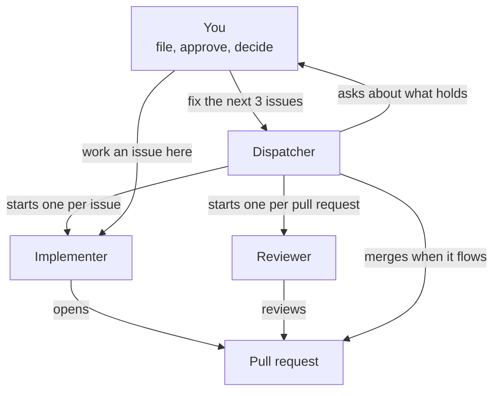
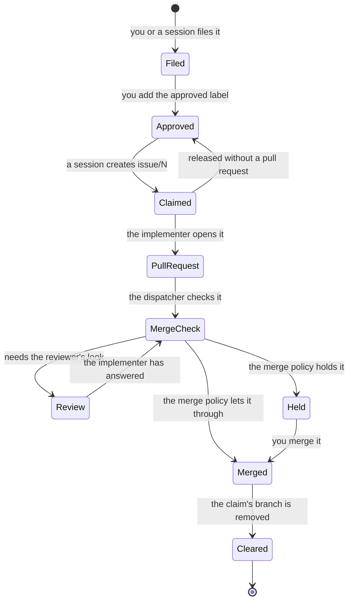
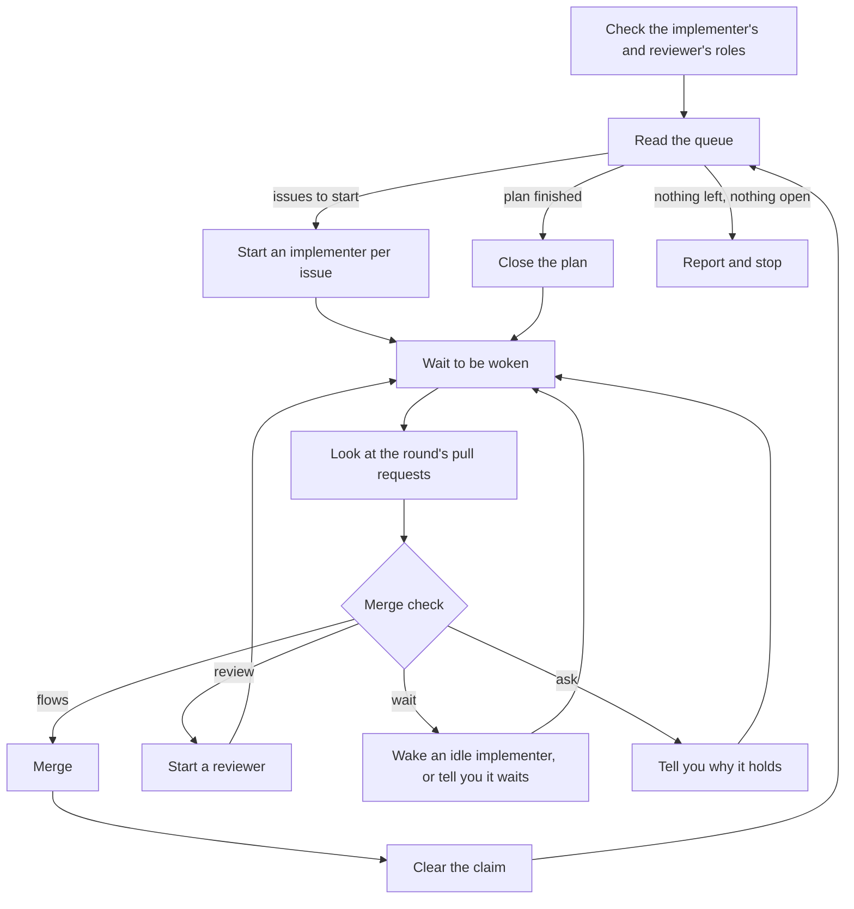

# Flywheel

Flywheel runs a repository's issue loop. The loop takes a GitHub issue from
the moment it is filed, through your approval, to a merged pull request. You
file issues by asking Claude, and Claude sessions file them too. You approve
each issue before any session works it, and you decide each pull request
that the merge policy holds.

Claude sessions do the rest of the work, each in one role. A **role** is one
part of the loop:

- the **dispatcher** starts a session for each approved issue, and starts the
  next one when a pull request merges.
- an **implementer** works one issue and opens its pull request.
- a **reviewer** reviews that pull request.

The diagram shows who starts whom. You ask one session for a round of
issues, and that session becomes the dispatcher. It starts an implementer
for each issue and a reviewer for each pull request, merges each pull
request the merge policy lets through, and asks you about the rest.



## What you need

Flywheel runs only in Claude Code, in the Claude desktop app, because the
dispatcher starts its sessions through the app. The repository needs all of
these:

- a git clone with a GitHub remote.
- `gh`, the GitHub command line tool, signed in to an account that can push
  to the repository. `gh auth status` says whether it is.
- `python3` on your `PATH`.

Install the plugin from Claude Code:

```text
/plugin marketplace add ScottHysom/claude-plugins
/plugin install flywheel@scott-claude-plugins
```

The marketplace does not update on its own. To pick up a new version:

```text
/plugin marketplace update scott-claude-plugins
```

## Setting up a repository

1. Install the plugin, as the "What you need" section says.
2. Ask Claude to adopt flywheel in your project, and follow the adopt skill's
   instructions as Claude runs it. Adopt compares your repository with the
   **controls** flywheel asks a repository to hold (rules, files and checks,
   such as a rules file for agents or a written review policy), and shows
   you what it found, as in this run, trimmed:

   ```text
   level 1 (Core): held
     [x] core-gates (one-command-per-gate): .flywheel/gates.json names `build`, `test`, `check`
   level 2 (Enforced): held
     [x] verify-gate (one-command-per-gate): .github/workflows/validate.yml runs `python3 .github/scripts/gate.py verify`
   level 3 (Measured): missing
     [ ] merge-policy (autonomy-scales-with-risk): .flywheel/merge-policy.md is missing

   the project holds level 2
   ```

   Adopt then asks which level of controls to adopt and each setting it
   cannot find in your project, writes the files in `.flywheel/`, creates the
   labels the loop needs, and files an issue for each control your
   repository is missing. [docs/adoption.md](docs/adoption.md) lists each
   level's controls. The "Labels" section and the "Filing an issue or a
   plan" section say more about the labels and the issues.
3. Commit the files adopt wrote. The "Files in `.flywheel/`" section says
   which of them you edit by hand later, and which a skill writes.
4. Have GitHub enforce the checks the merge policy asks for. On your `main`
   branch, under the repository's Settings, then Rules, set all of these:
   1. Require the status check that runs your `verify` gate to pass before
      merging.
   2. Require a branch to be up to date with `main` before merging.
   3. Allow nobody to bypass the rule (including administrators).
5. Copy the plugin's two workflow templates into your project's
   `.github/workflows/`, as the "Workflow templates" section says.
6. Approve the first issues, and ask for your first round, such as "fix the
   next 3 issues", from a session on a model and effort at least as strong as
   the implementer's and the reviewer's.

After you update the plugin, ask Claude to adopt flywheel again. It shows
only what changed since the last adoption, such as a control flywheel added.

## Everyday use

Each request below goes to Claude in a session in your repository. The
sections after the table give what happens in full, with output from a real
run.

| You say | What happens |
| --- | --- |
| "fix #12", "fix issue 12", "fix #12 and #14", "fix the next issue" | A round of those issues: an implementer for each, a reviewer for each pull request, and a merge check. |
| "fix #12 here", "fix the next issue in this session" | The session you are talking to works the issue. You review and merge the pull request yourself. |
| "fix the next 3 issues", "fix the next 3 issues starting at #12", "fix the issues in #653 three at a time" | A round that keeps that many issues in flight, from the queue or from a plan, until none is left. |
| "file an issue for …", "open an issue for …", "file this as a plan" | Claude drafts the issues, shows you a report, and files them once you approve. |
| `! gh issue edit 12 --add-label approved` | You approve issue 12, so a session may work it. |
| "review #671" | A reviewer reads the pull request against your review policy and posts its findings. |
| "measure the loop since 2026-10-01" | Spend, first-pass CI, findings and lead time for each pull request merged since then. |

### Fixing an issue

Ask Claude to fix an issue, such as "fix #12" or "fix issue 12", or the next
issue, such as "fix the next issue" or "fix the next issue in #653". The
session you ask becomes the dispatcher and works a round of that one issue,
as the "Fixing several issues at once" section says, with a reviewer and a
merge check. To send several issues you picked through the loop at once,
name them, as in "fix #12 and #14".

The dispatcher tells you why any issue you named cannot start:

```text
#685 adopt's first plan is refused in a repository that lacks the loop's labels cannot start: it is closed
#690 flywheel's README lacks an ordered path, a diagram and an example for a first-time adopter cannot start: another session holds its claim on issue/690
```

When the merge policy holds a pull request, the dispatcher tells you each
reason, and you merge it yourself:

```text
it changes requirements: its ## Requirements section names run-takes-issue-requests, owner-starts-round-with-one-command, brief-cmd-prints-issue-as-approved
it touches specs/flywheel.md, which the merge policy protects as specs/
the reviewer has not reviewed it
#700 holds at 9a88eb5, next: ask
```

### Working an issue in this session

Ask Claude to work an issue in the session you are talking to, such as "fix
#12 here" or "fix the next issue in this session". A request that does not
say "here" or "in this session" starts a round instead. Claude follows the
plugin's work-issue skill, and you review and merge the pull request
yourself. The skill:

1. claims the issue and tells you how the claim went, before any other work.
   When it took the issue from the queue and another session got there
   first, it takes the next free issue instead.
2. works from the issue as you approved it, with your comments since.
3. stops and asks when the issue is silent or wrong on something the work
   needs. An idea the issue does not ask for, it files as a new issue for
   you to approve, and goes on.
4. runs your `check` gate command, then your `verify` gate command when
   your gates name one, and does not open a pull request while either fails.
5. opens the pull request through your project's pull request skill, when
   you have one.
6. turns on the session's Auto-fix, so the app wakes the session when CI
   fails, the pull request has a conflict or a review comment arrives. Once
   the pull request has merged and the session has cleared its claim, it
   archives itself, and tells you when it cannot. Because the session
   posts under your GitHub account, the app may not wake it on your own review
   comments. So the skill also schedules a check, every minute while the
   session lasts, for review threads that wait on it.
7. answers each review thread with what it changed or why not, and leaves
   resolving the thread to the reviewer.

The claim is the first thing it reports:

```text
Claimed #690 on branch issue/690
```

To start such a session by hand, ask Claude for the brief for an issue. The
**brief** is the first message for a new session: the issue as you approved
it, your comments since, the session's role, and your project's gate
commands. A **gate command** is the command that says a piece of work is
done, such as running the tests. Claude refuses the brief for an issue
edited after you approved it, until you approve it again.

### Fixing several issues at once

Ask Claude for a round in any of these ways:

- a number of issues, such as "fix the next 3 issues", or "fix the next 3
  issues starting at #12" to leave out the issues before #12.
- a plan, such as "fix the issues in #653 three at a time".
- the issues you pick, such as "fix #12 and #14".
- one issue, such as "fix #12", or the next issue, such as "fix the next
  issue" or "fix the next issue in #653". The round is that one issue.

The session you ask becomes the dispatcher and follows the plugin's run
skill. It:

1. checks that `.flywheel/roles.json` gives the implementer and the reviewer
   a model and an effort, and stops naming each one you still need to fill
   in.
2. takes the next approved issues, in the plan's order when you named a
   plan. When you named issues, it takes those, and tells you why any of
   them cannot start, such as a missing approval or an open blocker.
3. starts one session per issue, each in its own worktree, with the issue's
   brief as its first message and the implementer's model and effort. Each
   of those sessions works its issue as the "Working an issue in this session"
   section says.
4. tells you each pull request as it opens, and starts a reviewer session on
   it. It starts the reviewer again once the implementer has answered the
   review.
5. merges a pull request when the merge policy lets it through, and
   otherwise tells you why it waits for you. You merge those yourself.
6. clears the claim once a pull request merges, and starts a session on the
   next issue, so the number you named stays in flight. A round of issues
   you named takes only those issues. It looks again whenever one of its
   sessions finishes a turn, or when you send it a message, such as after a
   merge.
7. closes a plan once every issue in it is closed, and stops once the queue offers
   nothing more and every pull request in the round has closed.

The app starts a session at or below the model and effort of the session
that starts it. So run the dispatcher on a model and effort at least as
strong as the implementer's and the reviewer's.

The queue offers the oldest approved issues that are free of a claim and of
an open blocker, as in this run:

```text
#234 check-skills.py drops the last line of a fence that is never closed
#235 check-skills.py exits 2 without a file or line on a fence line shlex cannot split
#236 check-skills.py guards an ALLOWED position no entry uses
```

Each time it is woken, the dispatcher looks at the round's pull requests, as
in this run, trimmed:

```text
merged #698 issue/665 at 2026-10-20T01:45:38Z
merged #699 issue/688 at 2026-10-20T02:09:25Z
merged #700 issue/689 at 2026-10-20T05:51:23Z
```

### Reviewing a pull request

Ask Claude to review a pull request, such as "review #671", or let the
dispatcher start a reviewer. Claude follows the plugin's review-pr skill,
which:

1. reads your review policy, and the pull request's description, threads
   and diff.
2. reviews the diff in each of the policy's passes, against the
   requirements the description lists.
3. posts its findings as one review, each opening with `**Claude:**` and its
   level, and no more P3 findings than the policy allows. It never approves
   a pull request or requests changes.
4. resolves, on a second look once the implementer has answered, each thread
   whose answer it accepts. A thread it leaves unresolved waits for you.

### Filing an issue or a plan

An issue reaches the loop from any of these:

- you, when you ask Claude to file an issue, or a plan that splits into
  several issues.
- the adopt skill, which files each control your project is missing, all in
  one plan.
- an implementer, which files an idea its issue does not ask for as a new
  issue, and goes on with its own issue.

Claude files each one the same way. It drafts each issue, then publishes a
report that shows every issue exactly as it will be filed. You read the
report, and comment on it or approve it. Claude files nothing until you
approve, and files exactly what the report showed. A report from a real run,
trimmed:

```markdown
# Plan report

Filing in [ScottHysom/claude-plugins](https://github.com/ScottHysom/claude-plugins).

## 1. `A`: A flywheel round stalls when Auto-fix does not wake the implementer on a repeat CI failure

- **Labels:** bug, plugin:flywheel
- **Blocked by:** nothing

> **Claude:**
>
> ## What's wrong
> …

1 issue(s), without a plan issue.

Approval token: `4b50df6f72547b94`
```

A plan of several issues also gets a **plan issue**: an issue that lists
the plan's issues in the order to work them, as its sub-issues. Each issue
that waits on another is marked "blocked by" it on GitHub. When every issue
in a plan is closed, ask Claude to close the plan, and Claude closes the
plan issue.

### Approving an issue

A filed issue waits until you approve it by adding the `approved` label, or
the label you chose for approving an issue under "Labels" below. Claude
offers only approved issues for a session to work.

Agents post under your GitHub account, so GitHub cannot tell an agent adding
the `approved` label from you adding it. The plugin's hook stops any command
Claude Code runs that would add it:

```text
Blocked: gh issue edit adds the approved label. Only the owner approves an issue, since agents post under the owner's account and GitHub cannot tell them apart. Ask the owner to add `approved`.
```

To approve an issue with Claude's help, run
`! gh issue edit <N> --add-label approved`: the `!` runs it in your own
shell, where the hook does not run. The hook reads the command's text, so it
stops a mistake rather than a determined workaround.

### Claiming and releasing an issue

Before a session works an issue, it **claims** it: it creates a branch named
`issue/` and the issue's number on GitHub. Only one session can create that
branch, so two sessions never work the same issue. Claude then adds the
claim label (`claimed` unless you chose another) and a comment, so the
claim shows in the issue list.
When a plan groups several issues under one plan issue, Claude offers
them in the plan's order.

When a session stops without finishing, ask Claude to release the claim.
Claude deletes the branch only when it is empty of work, unless you tell it
to drop the work too. When an issue turns out to need no change, tell Claude
to close it, and Claude closes it as not planned and frees its claim. Once the issue's pull
request merges, ask Claude to clear the claim, which removes the branch from
your clone. The dispatcher clears the claims of the pull requests in its
round itself.

Clearing a claim also moves your clone's local `main` up to `origin/main`, so
the next session loads the plugin as merged. When `main` holds a commit that
GitHub lacks, or its checkout has changes in the way, Claude leaves it and
says why.

### Measuring the loop

Ask Claude to measure the loop since a date, such as "measure the loop since
2026-10-01". Claude reports, for each pull request merged since then and as
a summary:

- **spend**: the tokens Claude Code used on the pull request's branch, read
  from the session records on your machine.
- **first-pass CI**: whether the checks passed the first time CI ran on the
  pull request.
- **findings**: how many findings the reviewer posted, at each level from P0
  to P3.
- **lead time**: the hours from when the issue was approved to the merge.

A run, trimmed:

```text
Since 2026-10-18: 15 merged pull requests.
#700 issue/689, merged 2026-10-20T05:51:23Z
  spend: 10,954,993 tokens (input 166, output 32,812, cache write 200,942, cache read 10,721,073)
  first-pass CI: green
  findings: P0 0, P1 0, P2 0, P3 0
  lead time: 22.8 hours
Summary:
  spend: 152,691,382 tokens over 15 of 15 pull requests
  first-pass CI: 14 of 15 green (93%)
  findings: P0 0, P1 0, P2 0, P3 0
  lead time: median 19.1 hours, from 0.2 to 81.2, over 15 of 15 pull requests
```

Read these before and after changing a role's model or effort in
`.flywheel/roles.json`, so you can tell whether the change paid off. Each
measure is there because it informs a decision like that one. A measure that
does not inform a decision is dropped. Claude says which measure it could
not compute for a pull request, and why.

## How the loop runs

An issue's life runs from filing to a cleared claim. You approve it, a
session claims it and opens a pull request, a reviewer reviews it, and the
merge check either merges it or holds it for you. The merge check sends a
pull request back to the reviewer until the reviewer has looked at its
latest commit. A session that stops
without a pull request releases the claim, and the issue waits to be claimed
again.



The dispatcher works in a loop. It checks each role's model and effort,
reads the queue, and starts an implementer per issue. Then it waits. Each
time one of its sessions finishes a turn, or you send it a message, it looks
at the round's pull requests. It merges, starts a reviewer, wakes an idle
implementer, or asks you, as the merge check says, and clears each merged
claim. It reads the queue again for each free place, and stops once the queue offers
nothing more and every pull request in the round has closed.



## Reference

### Files in `.flywheel/`

Every skill copies the plugin's script into a `.flywheel/` folder in the
project when it starts. Git ignores that copy, so it never reaches a commit.
The files you commit sit beside it:

| File | Holds | Change it | Commit it |
| --- | --- | --- | --- |
| `roles.json` | each role's tier, model and effort | by hand | yes |
| `gates.json` | your gate commands, and how to list and run your tests | by hand | yes |
| `review-policy.md` | what the reviewer works from | by hand | yes |
| `merge-policy.md` | which pull requests the dispatcher merges without you | by hand | yes |
| `adoption.json` | the plugin version, your level and the controls your project holds | by asking Claude to adopt flywheel again | yes |
| `passes-on-base.json` | each new test that passes before its change on purpose, with the reason | by hand, when you need it | yes |
| `plan/` | the filing report and Claude's record of what it filed | by asking Claude to file an issue | no, git ignores it |

The adopt skill writes `roles.json`, `gates.json` and the two policies, and
never overwrites a file that already exists. Once a file exists, change a
setting in it by hand. Ask Claude to adopt flywheel again to write a file
that is missing, such as one a later version of flywheel adds. Commit each
file once it is filled in, so every session reads the same choices.

#### `roles.json`

The file has one entry per role:

```json
"implementer": {
  "tier": 3,
  "model": null,
  "effort": null,
  "version": "0.1.0"
}
```

- `tier` is how much reasoning the role needs, from 1 (the most) to 3.
- `model` and `effort` are left for you. Claude asks you for each one when it
  adopts flywheel, at any level, because every round of issues starts its
  sessions from them.
- `version` is the version of this plugin the file was written under.

#### `gates.json`

Adopt writes `build`, `test`, `check` and `verify` under `gates` for you to
fill in, and keeps any gate the file already gives:

```json
{
  "gates": {
    "check": "make check",
    "verify": "make verify"
  }
}
```

At level 2, the same file also says how to list your tests and how to run
one. Claude writes these for you when your project uses pytest, and asks you
for them otherwise:

```json
{
  "tests": {
    "list": "python3 -m pytest --collect-only -q -p no:cacheprovider",
    "run": "python3 -m pytest -q -p no:cacheprovider {id}",
    "report": "python3 -m pytest -q -p no:cacheprovider --continue-on-collection-errors --junitxml={report} {files}",
    "paths": ["tests", "pytest.ini"]
  }
}
```

With them, `flywheel.py fails-on-base` runs each test a pull request adds
against your code as it was before the change, and fails the pull request
when a new test passes there. A test that passes there anyway would pass
without the change, so it proves nothing about it. Have your `verify`
command run it.

With pytest, `report` runs all the new tests at once and writes a JUnit XML
report (a file that says how each test ended), rather than starting pytest
once for each test. For another test runner, leave `report` out, and each new
test runs on its own with `run`.

#### `passes-on-base.json`

When a new test passes before the change on purpose, such as one that pins
behavior the change keeps, give its id and the reason here:

```json
{
  "tests": {
    "tests/test_app.py::test_keeps_old_format": "pins the format this change keeps"
  }
}
```

#### The review and merge policies

Each policy is a page you read and edit, with its settings in a JSON block
at the end. Claude lists each setting you need to fill in.

- `review-policy.md` is what the reviewer works from: the passes it reads a
  pull request in, the P0 to P3 scale it gives each finding (P0 is broken or
  unsafe, P3 is a nit), and `p3_cap`, the most P3 findings one review posts.
  Fill in `rules` with the files that hold your project's own rules, such as
  `["CLAUDE.md"]`.
- `merge-policy.md` says which pull requests the dispatcher merges without
  you. A pull request waits for you when any of these holds: it changes a
  requirement, touches a path under `protected`, or has a finding still
  open.

The merge policy is a request the dispatcher follows. The GitHub rules in
step 4 of the "Setting up a repository" section make GitHub enforce the
checks too.

### Labels

The loop sorts issues by label. Each issue Claude files carries one kind
label, and any other label your project's own instructions ask for:

| Label | Means |
| --- | --- |
| `bug`, `enhancement`, `documentation` | the kind of issue |
| `plan` | an issue that groups a plan's issues |
| `approved` | you agree a session may work the issue |
| `claimed` | a session has claimed the issue |

When you adopt flywheel, Claude asks for your repository's kind labels,
offering GitHub's own kinds first. To have each issue carry another label,
such as one for the area of the repository it touches, say so in your
project's `CLAUDE.md`. Claude also asks which headings an
issue holds, and what goes under each. By default they are "What's wrong",
"Evidence", "Done when" and "Requirements". Claude records headings of your
own in `.flywheel/issue-template.md`, which you commit.

Claude asks the same of a pull request's description: its sections, and the
one where the pull request names each requirement it adds, changes or
removes. Before merging without you, flywheel reads that section, and holds
a pull request that changes a requirement for you to decide. By default the
sections are "Scenario", with "Before" and "After" under it, then "Change",
"Requirements" and "Test plan". Claude records sections of your own in
`.flywheel/pr-template.md`, which you commit. When your project has no skill
of its own for opening a pull request, flywheel's open-pr skill writes the
description in that shape.

If your project keeps rules for how its prose reads, such as
`.claude/rules/prose-style.md`, Claude asks for them when you adopt flywheel.
It names each file in `.flywheel/pr-template.md` on a line of its own, as
`<!-- prose-rules: .claude/rules/prose-style.md -->`.

flywheel does not check prose itself. If you have a skill installed that
checks a file against prose rules, Claude also asks for its name, and adds it
to the template as `<!-- prose-check: SKILL -->`. open-pr then hands each
description to that skill, and rewrites what breaks the rules before you see
it. When the template names no such skill, or the skill is not installed,
open-pr opens the pull request without the check and tells you so.

If your project has its own skill for opening a pull request, that skill gets
Auto-fix only when the session's own command runs `gh pr create`. A skill that
opens the pull request through a script gets "Auto-fix is off" in the
implementer's report, and you turn it on by hand.

Each file on a `prose-rules` line has to follow the format that the skill on
the `prose-check` line reads. The skill refuses a file in another format,
and open-pr then gets a refusal in place of a check.

Your repository may already have labels that do some of these jobs, such as
`ready` for approving an issue or `epic` for a plan. When you adopt
flywheel, Claude asks which label your repository uses for each of these,
and flywheel then uses your labels:

- the label that approves an issue, `approved` by default.
- the label of a plan issue, `plan` by default.
- the label of a claimed issue, `claimed` by default.

Claude records your label answers in `.flywheel/labels.json`, which you
commit.
Flywheel adds and removes the claim label itself, so give it a label that
nothing else in your repository uses. If your repository already uses
`claimed` for something else, Claude says so and asks for another name.

A repository GitHub has just created lacks most of these, and Claude refuses
to file an issue whose labels the repository does not have. The adopt skill
names the missing labels and creates them once you agree.

### Workflow templates

The plugin ships two GitHub Actions workflows. Copy each into your project's
`.github/workflows/`:

- `templates/loop-report.yml` measures the loop on a schedule, finds labels
  and branches that disagree, and records the results in one open issue titled "Loop report", which it
  updates on each run. Each run measures the pull requests merged since the
  last run. Set its `cron` line to the schedule you want. It runs on Mondays
  until you do. GitHub does not have your session records, so that report
  leaves spend out.
- `templates/issue-closed.yml` takes the claim label (`claimed`, or
  the one `.flywheel/labels.json` names) off an issue when it closes, to keep
  the label meaning that someone is working on the issue. When the issue was
  the last open one in a plan, it also closes the plan issue, so an open plan
  issue always means work remains.

### Levels

Flywheel sorts its controls into three levels, each built on the one below:

- Level 1 has agents build only what someone asked for.
- Level 2 backs that with checks.
- Level 3 has the loop measure itself.

[docs/adoption.md](docs/adoption.md) lists each level's controls. When
Claude adopts flywheel, it asks which level to adopt and never chooses one
for you. It asks for the settings each level needs:

- at every level, the gate commands in `gates.json` and each role's model
  and effort in `roles.json`, since every round of issues starts its
  sessions from them.
- from level 2, the review policy and the commands that list and run your
  tests.
- at level 3, the merge policy.

For each gate, Claude offers the command it finds in your project. Claude
also adds flywheel's rules for agents, up to your level, to your project's
`CLAUDE.md`, beside the rules you already have, and records the plugin
version, your level and the controls your project holds in
`.flywheel/adoption.json`.

### Flywheel's docs

Flywheel is built on a way of building software with agents: every behavior
traces to a need someone stated, and each task gets an agent matched to it.
The plugin's `docs/` folder holds it. Start with
[docs/README.md](docs/README.md).

Flywheel's principles and stage rules each have an id, such as
`one-home-per-artifact`. A spec, a template or a skill that cites one points
to the document in `docs/` that defines it. The docs carry the plugin's
version, so a repo that records which flywheel version it adopted has
recorded which version of the docs it follows.

### What this version does

This version of the plugin:

- installs the plugin's script.
- ships the docs that define how the loop works and why.
- assesses which of flywheel's controls a project holds.
- writes the file that says which model each role runs on, and the review
  and merge policies.
- files an issue or a plan of issues.
- guards the label that approves an issue.
- takes and frees the claim on an issue.
- carries the dispatcher's, the implementer's and the reviewer's skills.
- measures the loop, and ships the workflows that report on it and clear
  the claim label.
