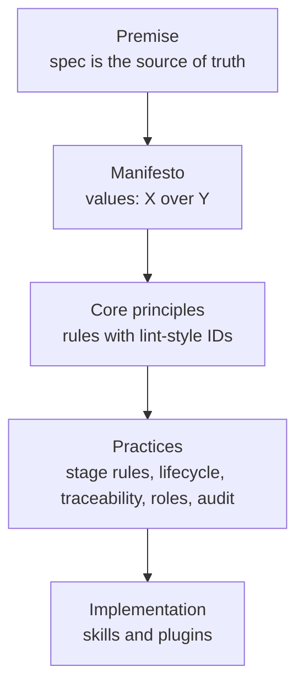
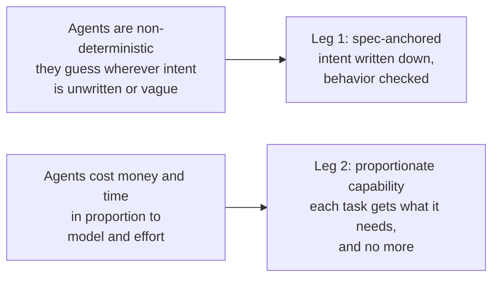
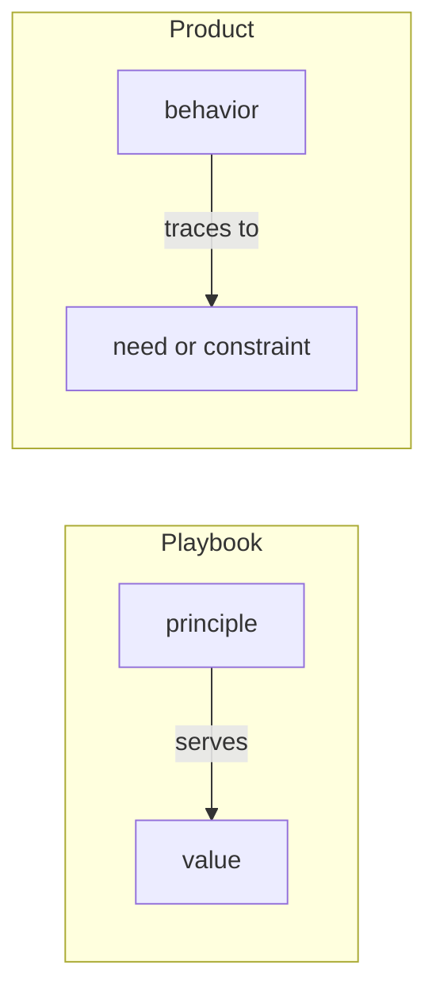

# The flywheel playbook

A playbook with two legs: a living spec that code always matches, and agents matched to tasks by capability and cost. Every behavior in the code traces to a need someone stated.

## How to read this repo

This repo covers the top four layers. The flywheel plugin, which ships these documents, implements them, and its skills cite principles and stage rules by ID, for example "this skill enforces no-merge-without-alignment."

| Repo file | Covers | Leg |
| --- | --- | --- |
| `README.md` | Why it exists, premise, manifesto, core principles | Both |
| `stage-rules.md` | Stage rules: how each stage applies the core principles | Both |
| `lifecycle.md` | Stages, spec corpus, gates, pause-on-discovery loop | 1: spec-to-code |
| `traceability.md` | Needs, constraints and requirements; the chain from code to need; admission | 1, with scripts for leg 2 |
| `roles.md` | Agent roles, capability tiers, model and effort, escalation | 2: right agent for the task |
| `audit.md` | Periodic whole-system audit | Both |
| `metrics.md` | Leading and lagging measures per stage; spend; control bands | Both |
| `adoption.md` | Adoption levels; assessing and adopting a new or existing repo | Both |
| `glossary.md` | Shared vocabulary and acronyms | Both |

The playbook depends on no tool or model. Tools are named only as examples, such as `CLAUDE.md` for the file an agent reads every session. Model names change every few months; roles and tiers do not.

## Why it exists

Agents bring two problems that earlier methods never had to solve. Each leg answers one.

- **Agents are non-deterministic.** Given the same spec twice, an agent may write different code. Wherever intent is unwritten or vaguely written, it fills the gap with a plausible guess. So intent is written down, and behavior is checked rather than trusted (leg 1).
- **Agents cost money and time** in proportion to the model and the effort used. The strongest model at maximum effort is the safest choice for any one task, and wasteful across a hundred. So each task gets the capability it needs, and no more (leg 2).

Both answers age fast. Models, effort settings, tools and prices change every few months, so the playbook itself is measured and improved by trial (Measured improvement, below).

A test for any new rule: which of these two problems does it guard against, or does it keep the answers current? If none, it is probably ordinary good engineering, and belongs in a project's own conventions rather than here.

## The premise

The spec is the source of truth, and code is its implementation. The spec defines what the product should be, for as long as changes are planned. Every intended change to behavior starts as a spec change and is done only when the code matches the spec.

This is *spec-anchored* development. It differs from *spec-first* development, where the spec is written once and then drifts away from the code.

## Manifesto

A manifesto states what we value when two good things conflict. Each line reads "X over Y." Both sides have worth, but when you can't have both, X wins. For example, thorough documentation is useful, but a client and team who understand the same thing is worth more.

The manifesto doesn't say what to do. It says which way to lean, including in cases no rule covers. The principles below turn these values into specific rules. The form comes from the [Agile Manifesto](https://agilemanifesto.org/) (2001).

We value the items on the left more than those on the right.

- **Shared understanding** over exhaustive documentation
- **Explicit decisions** over inferred intent
- **Verified behavior** over apparent progress
- **Living specs** over frozen requirements
- **Stated needs** over plausible features
- **Proportionate capability** over maximum capability
- **Enforced checks** over written instructions
- **Measured improvement** over a settled routine

Five of these need a word more.

- **Shared understanding has two audiences.** The first is the people on the project, the client included. They can fill gaps by talking; the risk is that each walks away with a different picture. The second is the human and the agent. An agent has no hallway and no tacit knowledge, so anything unwritten or vaguely written, it guesses. For both audiences, a short spec that leaves nothing to guess beats a long one nobody reads in full (sufficient-not-exhaustive).
- **Explicit decisions and stated needs are different.** Stated needs decide *whether* to build something. Explicit decisions decide *how* it behaves in the gaps. An agent can fail either way: by building something nobody asked for, or by picking an answer nobody chose.
- **Apparent progress is what an agent produces easily:** a large diff, a green unit-test run, a confident summary. None of these shows the behavior is right.
- **Proportionate capability cuts both ways.** Too much wastes money and time. Too little wastes rework: a weak model on a design task can cost more than a strong one would have.
- **Measured improvement keeps the playbook current.** A settled routine has worth: it is predictable and cheap to run. But a newer model, a different effort setting or a faster CI tool may do the same work better or cheaper. A measure earns its keep only when it drives a decision, such as a change kept, a change reverted, or a quote to a client.

## Principles

Principles come in two tiers.

- **Core principles** (18, below) say what the playbook holds to. They stay true whatever the tools.
- **Stage rules** (21, in [stage-rules.md](stage-rules.md)) say how a stage applies a core principle. Most name a command, a format or a scale.

Both have a stable ID, named like a lint rule: kebab-case, at most four words, readable on its own. Skills and plugins cite these IDs. Never rename or reuse an ID; retire it instead (see [Retired IDs](#retired-ids)).

Each principle and stage rule serves at least one manifesto value. The **Serves** column names it by the value's left side. A rule that serves no value is either missing a value or doesn't belong. This mirrors trace-behavior-to-need one layer up:

### Core principles

| Stage | ID | Principle | Serves | Why | Anti-pattern |
| --- | --- | --- | --- | --- | --- |
| All stages | spec-is-source-of-truth | The spec is the source of truth; code implements it. | Living specs | Code shows *what* the system does, not what it *should* do. | Treating the code as the spec ("read the code to find out"). |
| All stages | humans-decide-agents-record | Humans decide; agents record, propagate and check. | Explicit decisions | Keeps accountability with people and toil with agents. | An agent silently choosing product behavior. |
| All stages | one-shared-vocabulary | One shared vocabulary across client, spec, code and agents. | Shared understanding | Mismatched words are where meaning gets lost. | The same concept named three ways. |
| All stages | trace-behavior-to-need | Every behavior traces to a need someone wants or a constraint the platform forces. | Stated needs | Tests show a behavior works, not that anyone needs it. | A feature justified by symmetry, completeness or "it might be useful." |
| All stages | one-home-per-artifact | Each artifact has one home: the ticket, the spec or the PR. Everything else links to it. | Shared understanding | Two copies of the same artifact drift apart. | An intent in the tracker and a different one in the repo. |
| All stages | checks-over-instructions | Enforce each rule that matters with a check the agent cannot edit: the links from code to need, the owner's approval and the stage gates. A rule an agent only reads is a request. | Enforced checks | Agents drift from instructions; a failing check is not optional. | Relying on a rule in the agent's instructions file alone to keep unneeded behavior out. |
| Scope | slice-thin-increments | Start with a minimum viable product (MVP); each increment runs the whole loop, spec to shipped. | Living specs | Small batches keep feedback fast and prevent a long up-front planning phase. | Specifying the whole product before building any of it. |
| Spec | source-needs-outside-code | Needs come from sources outside the code: the client, a brief, a ticket. Each cites its source. | Stated needs, Shared understanding | An agent reading code finds a reason for everything in it. A cited source lets the client confirm the need in their own words. | Writing the spec by reverse-engineering the code. |
| Spec | owner-admits-every-need | A new need or constraint enters the spec only through the owner's approval. | Stated needs, Explicit decisions | Either one justifies behavior, so an invented one lets in behavior nobody asked for. | Approving a ticket's idea and, unseen, the behavior its "Done when" implies. |
| Spec | interrogate-before-building | Interrogate before you build: an agent hunts for gaps, a human answers. | Explicit decisions, Shared understanding | Agents find holes fast; only humans own intent. Questions are how the agent and the human get on the same page. | Handing a thin spec to coders and letting them guess. |
| Spec | sufficient-not-exhaustive | A spec is sufficient when an implementer can build the increment without guessing intent. Stop there. Every sentence states a behavior, rule, constraint or decision. | Shared understanding, Explicit decisions | Every agent reads the spec on every run, and the client must be able to read it too. Text past sufficient costs context and buries the rules that matter. Text short of it leaves gaps an agent fills with a guess. | Forty edge cases in prose that five rules and their tests would cover. Or the opposite: a one-line spec that leaves the agent to invent the rules. |
| Plan | match-capability-to-task | Match capability and effort to the task; escalate up, don't guess. | Proportionate capability | Strong models at high effort are scarce, slow and costly. Fast models at low effort are cheap but shallow. Too little capability costs rework; too much costs money and time. | The strongest model at maximum effort for everything, or the weakest for design. |
| Plan | scripts-do-deterministic-work | Scripts do deterministic work; a model sits between two commands only to judge or to reach a tool. | Proportionate capability | A script is the cheapest and most reliable worker. A model carrying values between commands costs context and can go wrong. | An agent re-typing one command's output into the next. |
| Build | pause-on-discovery | When coding shows a change is needed, pause that unit, fold the change into the spec as a whole, then resume. A change that is only possible is filed as a candidate need, and work goes on. | Living specs, Explicit decisions | Build time is where most hidden requirements appear, and a local fix can conflict with other parts of the spec. Pausing for every idea would stall the work. | A coder adjusting the plan in code and moving on. |
| Build | agents-never-weaken-checks | An agent never loosens a test or check to make it pass. A new test must fail on the code before the change. | Enforced checks | A check its author can weaken checks nothing. | Editing an assertion until the test goes green. |
| Verify | separate-generation-from-verification | Separate generation from verification. | Verified behavior | A reviewer with fresh context catches what the author cannot. | The coding agent approving its own work. |
| Release | autonomy-scales-with-risk | Agent autonomy is set per change type and environment, in a written merge policy. Low risk flows; high risk keeps a human gate. The owner writes the policy, so the decision stays human (humans-decide-agents-record). | Proportionate capability | Human attention goes where the risk is. | A human approving every typo fix, or an agent merging to production unchecked. |
| Maintain | improve-by-measured-trial | Improve the playbook by trial: change one thing (a model, an effort setting, a tool or a step), measure it against a baseline, and keep it only if the measures hold or improve. Every measure names the decision it informs. | Measured improvement | Models, tools and prices change every few months. A measured trial makes each change a safe bet, and a measure nobody acts on is overhead. | Switching to a model or tool because it is new, or keeping dashboards nobody reads. |

**Example (pause-on-discovery).** A coding agent finds the spec doesn't say whether deleted items go to a trash folder. It pauses that unit and escalates. The human answers "trash, kept 30 days." The agent updates the product spec and checks what else the rule affects, and then coding resumes. Had the agent only noticed that a "restore all" button *could* be useful, it would file that as a candidate need and keep building.

### Retired IDs

None yet. IDs become stable once any repo records an adopted playbook version (see [adoption.md](adoption.md)); until then they may change freely.

After that, a retired ID is listed here with the date it was retired, what replaced it and why. It is never reused. A repo that recorded it during adoption reads this list to find what replaced it.

## Open questions

- [x] Decided: improving the playbook itself is a value (Measured improvement). Measures exist to drive decisions: improvement trials, triage and estimating. See improve-by-measured-trial and [metrics.md](metrics.md).
- [x] Decided: the name is "the flywheel playbook", "the playbook" for short.
- [x] Decided: stay spec-anchored, not *spec-as-source*. Humans, agents or both may edit code, under the same rules.
- [ ] Which spec documents are the minimum for a small consulting engagement? Proposed: the needs spec (`specs/`) alone, with its out-of-scope list, and a PRD only when the client needs one. See [traceability.md](traceability.md).
- [ ] For bigger projects, how much of the PRD and design documents is still needed once needs and constraints cover the product? Candidates for what remains: success metrics, architecture reasons (ADRs), visual design and the threat model. Proposed: collapse requirements and design into the needs spec and its design notes by default, and split a document out only when a different person must sign it. See the reconciliation note (`notes/ai-native-sdlc-reconciliation.md` in the playbook's Cowork archive), collision 3.
- [x] Decided: an agent may merge only under a written merge policy whose autonomy scales with risk (autonomy-scales-with-risk). The policy names the change types and environments that qualify, the checks that must pass, and the findings that block. The playbook sets the principle; each project writes its policy in its implementation layer, and a human can revoke it at any time.
- [x] Decided: spec/code alignment is checked with traceability IDs and CI checks for every link, plus owner review of whether each need is real. See [traceability.md](traceability.md).

## Sources

- Jeremy's LinkedIn post (September 2026): living specs, 8 coder + 8 reviewer agents, tiered models, periodic audit.
- [SPEC-METHODOLOGY.md](../../../SPEC-METHODOLOGY.md), claude-plugins (2026). The "needs before code" method behind traceability.md, and its worked example.
- [The AI-Native SDLC Playbook](https://claude.com/blog/the-ai-native-sdlc-playbook), Claude blog. Source of the plan gate, the single verification command, evals of agent instructions, written review policy, autonomy by risk and the Maintain stage. See the reconciliation note (`notes/ai-native-sdlc-reconciliation.md` in the playbook's Cowork archive).
- [Understanding Spec-Driven Development: Kiro, spec-kit, and Tessl](https://martinfowler.com/articles/exploring-gen-ai/sdd-3-tools.html), Birgitta Böckeler, October 2025. Source of the spec-first / spec-anchored / spec-as-source levels.

## License

MIT, for the documents and for any code that joins them. See [LICENSE](../../../LICENSE).
