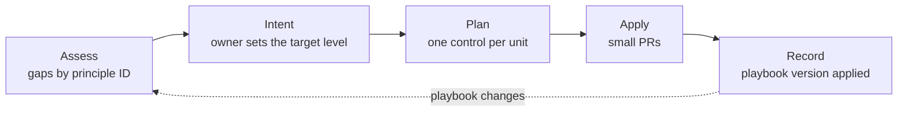

# Adoption: bringing a repo under the playbook

This document states what "adopted" means, for a new repo or an existing one, by level and principle ID. A plugin or skill in the implementation layer (the tooling a project uses to carry out the playbook) does the assessing and the applying, and cites the IDs below. In the flywheel plugin, `flywheel.py assess` does the assessing, and its docstring says what counts as evidence for each control.

**A new repo is an existing repo with every gap open.** So both take one path:

Adoption follows the playbook's own lifecycle. The gap report is the intent. The owner sets the target level and approves it. Each control is one unit of work, landed as its own PR (stack-small-reviewable-prs). A script does the assessing and the file writing. A model does only what needs judgment, such as interviewing the owner (scripts-do-deterministic-work).

## Levels

Each level is a floor. A repo may adopt a control from a higher level early.

### Level 1: Core, building only what someone asked for

| Control | Principle IDs |
| --- | --- |
| Rules for agents, in the file agents read every session | trace-behavior-to-need, humans-decide-agents-record |
| A needs spec for each component, opening with its out-of-scope list | list-out-of-scope-first, source-needs-outside-code |
| The ticket as the home of each change's intent; the owner approves it | owner-admits-every-need, one-home-per-artifact |
| The `build`, `test` and `check` commands | one-command-per-gate |
| Tests written first and named for behavior | write-behavior-tests-first |

Level 1 is done when `check` passes, and every change starts from an approved ticket.

### Level 2: Enforced, by checks rather than requests

| Control | Principle IDs |
| --- | --- |
| Traceability checks in CI: tests cite requirements, requirements sit under needs, PRs list what they change, coverage floors hold | checks-over-instructions, no-merge-without-alignment |
| The `verify` command, run by CI on every PR | one-command-per-gate |
| New tests must fail on the base; agents cannot loosen checks | agents-never-weaken-checks |
| Approval kept out of agent reach, by a hook or CI check | checks-over-instructions, owner-admits-every-need |
| A plan approved before code | approve-plan-before-code |
| A written review policy and a fresh-context reviewer | review-against-written-policy, separate-generation-from-verification |

Level 2 is done when every check fails rather than warns, and the list of untraced items is empty.

### Level 3: Measured, by a loop that watches itself

| Control | Principle IDs |
| --- | --- |
| Evals for the agent's instructions, rerun on every change to them | eval-instructions-on-change |
| Agents assigned by role and tier, each tier with a model class and a default effort, with the mapping in the implementation layer | match-capability-to-task |
| A written merge policy | autonomy-scales-with-risk |
| A scheduled audit | audit-on-schedule |
| Measures for each stage, spend per merged unit, with control bands | measure-the-loop, scripts-detect-models-diagnose |
| Improvement trials, one change at a time against a baseline | improve-by-measured-trial |
| Repeated mistakes climb to checks | repeat-mistakes-become-checks |

Level 3 is done when the audit has run on its schedule, the eval suite gates a change, and the measures have enough history for bands.

### Choosing a level

- **Level 1** suits a weekend tool or a throwaway prototype.
- **Level 2** suits ongoing solo work and most consulting engagements.
- **Level 3** suits a product with users, a team, or agents that merge.

## New and existing repos

**A new repo** adopts Level 1 in its first commit, with checks as errors from day one. It has nothing to sift. Level 2 follows with the first feature.

**An existing repo** adopts one control at a time, in the order of the tables above. Its checks start as warnings and list each flagged item against the ticket that will fix it. That list only shrinks. The trap is reading needs from the code, because an agent reading code finds a reason for everything in it (source-needs-outside-code). Behavior that nobody can place goes to the owner with a recommended outcome. [traceability.md](traceability.md), under "Adopting it", has the steps and the outcomes.

## The record

After each step, the repo records which playbook version it adopted, and which controls, by principle ID. Where the record lives is the implementation layer's choice. In the flywheel plugin, `flywheel.py record` writes it to `.flywheel/adoption.json`.

Re-running the assessment against a newer playbook version then shows exactly what changed. A new principle shows as a new gap; a changed one shows what to revisit. This works only because principle IDs are never renamed or reused.

**Example.** A repo at Level 2 recorded the playbook version it adopted. The playbook later adds a principle at Level 2. Re-running the assessment shows one gap, cites its ID, and proposes one PR.

## What adoption never writes

Some things only the owner can supply. The assessment asks for them and never invents them:

- **Needs and constraints.** They come from sources outside the code, and the owner admits each one.
- **The target level.**
- **The merge policy's terms**, and which changes it lets agents merge.
- **The model behind each tier.**
