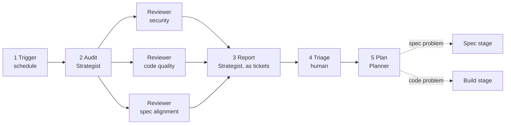

# Audit: the periodic whole-system pass

A scheduled audit catches the slow drift that per-PR reviews miss (audit-on-schedule). It uses the same checklist every time, so results are comparable run to run and should shrink over time.

## Workflow

The Strategist fans the checklist out to Reviewers in parallel, then merges what they find. A schedule starts the audit, and humans decide what to act on.

1. **Trigger.** A scheduled task starts the audit. A human may also start one at a milestone. Starting is deterministic; deciding stays human (scripts-detect-models-diagnose).
2. **Audit.** The Strategist splits the checklist by area and hands each area to a Reviewer with a fresh context.
3. **Report.** The Strategist merges findings, removes duplicates and assigns a severity (P0 to P3). Each finding becomes a ticket, its one home (one-home-per-artifact). A ticket names the requirement ID the finding breaks, if it breaks one.
4. **Triage.** A human accepts, defers or rejects each ticket. A finding that breaks an existing requirement may be fixed directly. A finding that needs new behavior goes to Scope and waits for the owner's admission (fixes-restore-never-add).
5. **Plan.** The Planner turns accepted findings into work units. Spec problems go through the Spec stage first; code problems go straight to Build.

| Role | Tier | Part in the audit |
| --- | --- | --- |
| Human | n/a | Triages findings; may start an extra audit |
| Strategist | 1 | Splits the checklist, merges findings, assigns severity |
| Reviewer | 2 | Audits one area in a fresh context |
| Planner | 2 | Turns accepted findings into work units |
| Spec writer, Implementer | 2, 3 | Fix findings through the normal lifecycle |

## Checklist

1. **Spec/code alignment.** Every requirement is verified; every behavior in the code traces to a need or constraint (trace-behavior-to-need). Anything with no need is speculative generality: a candidate for removal, put to the owner.
2. **Spec self-consistency.** No two documents in the corpus contradict each other.
3. **Code quality.** Duplication, dead code, refactoring opportunities, readability.
4. **Latent bugs.** Edge cases, error handling, concurrency.
5. **Security.** Checked against the security spec.
6. **Privacy.** Data handling checked against the privacy spec.
7. **Documentation.** External and inline docs match the code.
8. **Method.** Trends are reviewed, not just breaches. Each measure still names the decision it informs. Anything that lags, costs too much or runs slowly becomes a proposed improvement trial (improve-by-measured-trial).
9. **Controls.** Every mistake an agent has made twice has a check, hook or eval behind it (repeat-mistakes-become-checks). The eval suite passes on the current tier-to-model mapping (eval-instructions-on-change).

## Severity scale

| Level | Meaning | Response |
| --- | --- | --- |
| P0 | Broken, unsafe or leaking data | Fix before anything else |
| P1 | Wrong behavior or real risk | Fix this cycle |
| P2 | Quality or maintainability issue | Schedule |
| P3 | Nice to have | Backlog or ignore |

P0 to P3 are priority levels, and PR review uses the same scale (review-against-written-policy). A review nit is P3. Principle IDs are words, so the two never clash.

## Cadence

A scheduled task runs the audit monthly, or every few hundred merged PRs, whichever comes first. A human may add one at a milestone. Findings become ordinary tickets that go through the lifecycle, starting at Maintain in [lifecycle.md](lifecycle.md).
