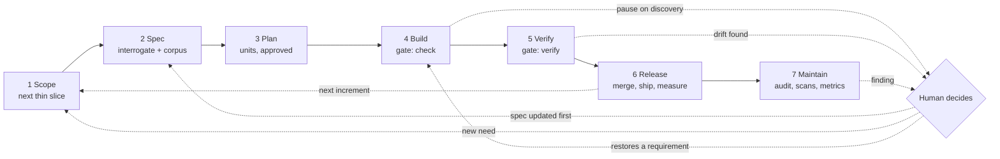
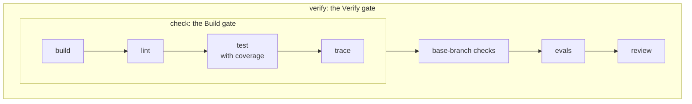

# Lifecycle: from intent to living spec

Each increment moves through six stages, and a seventh, Maintain, runs alongside them all. These are the stages the principle and stage-rule tables use. Principles tagged "All stages" apply throughout.

Three loops keep it iterative and in sync.

- **The outer loop** carries what each release teaches into the next increment's scope.
- **The inner pause-on-discovery loop** stops a unit when build or review finds a needed change. A human decides, the agent updates the spec, and coding resumes against the new spec (change-spec-before-code).
- **The maintain loop** turns findings into tickets. A fix that restores an existing requirement goes to Build. A finding that needs new behavior goes to Scope and waits for the owner, like any new need (fixes-restore-never-add).

## Stages and gates

| Stage | In | Out | Home of the output | Owner | Gate to move on |
| --- | --- | --- | --- | --- | --- |
| 1 Scope | Product idea, or what the last release or a finding taught | Intent and the next thin slice (MVP first); a draft PRD beyond a small tool | The ticket; the PRD in the corpus | Human | Owner approves the ticket; the slice is small enough to ship end to end |
| 2 Spec | Intent and slice | Interrogated spec corpus for this slice | The spec corpus | Agent asks and writes; human answers and approves | No blocking questions; corpus consistent; deferred decisions marked; every requirement under an admitted need or constraint |
| 3 Plan | Spec for this slice | A written plan: work units, dependencies, parallel batches | The PR description, or a committed plan on bigger projects | Planner agent; owner approves | Owner approves the plan (approve-plan-before-code); each unit cites the requirement IDs it builds, and those requirements are its acceptance criteria |
| 4 Build | One work unit | Code and tests | The branch | Implementer agent | `check` passes (one-command-per-gate); no test or check weakened (agents-never-weaken-checks); discoveries paused and escalated, not guessed |
| 5 Verify | PR | Review findings, P0 to P3 | The PR thread | Reviewer agent | `verify` passes, evals included; no open P0 or P1 under the written review policy (review-against-written-policy); spec and code aligned (no-merge-without-alignment) |
| 6 Release | Approved PRs | Shipped increment; experiment results | The main branch and its version | Human, or agent under the merge policy (autonomy-scales-with-risk) | Spec matches what shipped; results feed the next Scope |
| 7 Maintain | The shipped system, a schedule, metrics | Findings | Tickets | Scripts detect; agents diagnose; human triages | Each finding triaged; a fix restores a requirement or waits for admission (fixes-restore-never-add) |

Each output has one home, and everything else links to it (one-home-per-artifact). A second copy, such as an intent kept both in the tracker and in the repo, drifts.

## The spec corpus

A set of documents, not one. Scale it to the project: a weekend tool needs only the needs spec; a client product may need all seven.

The needs spec is the traceable layer of every corpus. The other documents feed it: a PRD section is the source of a need, and the security spec is the source of a constraint. See [traceability.md](traceability.md). How much of the other documents a bigger project still needs is an open question in the README.

**Rule: spec documents are written and changed only in the Spec stage.** The one exception is the PRD's first draft, which comes out of Scope. Plan, Build, Verify, Release and Maintain read the corpus but never edit it. One narrow exception keeps small changes light: a new or changed requirement under an existing need may ride in the PR that builds it, listed in the PR description, and the owner's review approves it. A new need or constraint always goes through Spec (owner-admits-every-need). When they find a needed change, work pauses and the change goes back through Spec (pause-on-discovery). Each increment revisits the corpus in its own Spec stage, adding full detail only for that slice (spec-next-increment-deeply).

| Document | Answers | When needed | First drafted | Changed |
| --- | --- | --- | --- | --- |
| Needs spec (`specs/`) | Who needs what and why; platform constraints; one line per required behavior | Always | Spec | Spec; requirements under an existing need also in a PR |
| PRD (Product Requirements Document) | Why build it, for whom, what success means | Beyond a small tool | Scope | Spec only |
| Product spec | What it does, screen by screen and rule by rule | When flow and narrative matter beyond the needs spec | Spec | Spec only |
| Technical Design Document | How it is built: architecture, data, interfaces | Anything beyond a script | Spec | Spec only |
| Design system | How it looks and behaves: components, tokens, patterns | Anything with a UI | Spec | Spec only |
| Privacy spec | What data is collected, kept and shared | Any personal data | Spec | Spec only |
| Security spec | Threats, trust boundaries, controls | Anything networked or multi-user | Spec | Spec only |

Decision records (ADRs) can sit beside the corpus to capture *why* a choice was made.

## Slicing and depth (slice-thin-increments, spec-next-increment-deeply)

Scope decides how much of the product this pass of the spec covers. The first slice is the MVP; each later slice adds one coherent capability.

- The PRD covers the whole product at outline depth: goals, users, success measures.
- Other documents get full detail only for the current slice. Later slices stay as headings with a line or two each.

**Example.** An invoicing app's MVP slice specs "create and send an invoice" in full. "Recurring invoices" stays a one-line placeholder until its own increment.

## Interrogation (interrogate-before-building)

In the Spec stage, an agent reads the draft and lists every gap, ambiguity and contradiction it finds. A human answers. The agent folds the answers into the corpus and asks again until nothing blocks the slice.

- Needs come from sources outside the code, and each cites its source (source-needs-outside-code). "The code does it" is not a source.
- Each spec opens with an out-of-scope list (list-out-of-scope-first).
- Questions are kept with their answers, so the reasoning isn't lost.
- Expect growth. In the source example, interrogation made the draft about three times longer. The growth is answers to real gaps, and the sufficiency test below still applies.

## Client-facing variant

For consulting work, the Spec stage includes the client. Job stories ("When a renter returns a car, they want every charge listed...") are written in the client's words, so the client can confirm the needs directly. Concrete examples ("given this order, the invoice shows...") are the fastest way for a client to confirm or correct a rule. The client signs off on the interrogated spec before Plan.

## Deferred decisions (defer-decisions-explicitly)

Not every question needs an answer now. A deferred decision is written into the spec where it applies, as a marker with the question, the current default and the trigger to revisit it.

**Example.** "DEFERRED: tax rules outside the US. Default: US only. Revisit: first non-US customer." Coders treat the default as the spec; the marker keeps the gap visible.

## Sufficient, not exhaustive (sufficient-not-exhaustive)

A spec is sufficient when an implementer can build the increment without guessing intent. Stop there. Both directions cost:

- **Too short** leaves gaps, and an agent fills each one with a plausible guess.
- **Too long** costs context on every agent run, buries the rules that matter, and is too much for a client to read and confirm.

**The test.** Could a fast, low-tier implementer build this increment without asking a question whose answer would change the behavior? If not, something is missing. If so, more text is cost.

Every sentence in the corpus should state a behavior, rule, constraint or decision. Spec reviews cut text that doesn't, and collapse lists that a rule covers.

- Keep: "Invoices lock once paid; edits create a credit note."
- Cut: "The invoicing module is an important part of the system."
- Collapse: forty late-fee cases written out one by one become five rules, with the cases as tests that cite them.

## Prototypes (prototype-to-learn)

A prototype is built to answer a question named in the spec, such as "will users find bulk edit?" Its findings go into the spec during the Spec stage. The prototype code is thrown away or rebuilt from the updated spec. It never merges as-is.

## Plan approval (approve-plan-before-code)

Before any code, the planner writes a plan: the work units, their order, the files each touches and the requirement IDs each builds. The owner approves it or sends questions back. Until then, agents stay read-only, enforced by the tool where it can be (plan mode, in tools that have one).

- **Its home** is the PR description on solo and small work. A bigger project may commit it.
- **It is disposable.** A plan is never spec, and nobody updates it after the code lands.
- **A one-unit fix may skip the approval.** Its PR description still names the requirement it builds or restores.

The two directions of questioning meet here. In Spec, an agent interrogates the human's intent. In Plan, the human interrogates the agent's plan.

**Example.** A plan for "send an invoice" lists three units: the `send` command and its tests, the email template, and the audit log entry. Each names its requirement IDs. The owner asks why the audit log is needed, finds no requirement for it, and cuts the unit.

## Gate commands (one-command-per-gate)

Every repo exposes four commands, each inside the next. The playbook names them; each repo's task runner defines them.

| Command | Does | Run |
| --- | --- | --- |
| `build` | Compile and package. A no-op where nothing compiles. | By `check`, or alone |
| `test` | Unit tests only, fast, with no coverage. Keeps the meaning its ecosystem gives it, such as `npm test` or `pytest`. | Many times per unit, in the test-first loop |
| `check` | `build`, then lint, format and type checks, then `test` with coverage, then the traceability checks. Needs no network. | Once per unit, before calling it done |
| `verify` | `check`, then whatever needs the base branch, independence or money: diff coverage, the PR's spec changes, new tests failing on the base, evals, the reviewer | On every PR in CI; locally on demand |

- **A unit is done when `check` passes. A PR is ready when `verify` passes.** Put that line where agents read it every session.
- **Each command prints its chain when it starts**, such as `verify: check (build, lint, test, trace), then base-branch checks, evals, review`. The names alone do not show which contains which.
- **CI runs the same commands** the agent ran, so the two cannot drift.
- **Agents reach for `test` by default.** A green `test` is not a done unit. CI enforces this: `verify` runs `check` (checks-over-instructions).

## Pause on discovery (pause-on-discovery)

When an implementer finds the spec silent or wrong, it stops work on that unit and escalates. It does not pick an answer in code. The question goes through impact analysis and a Spec-stage change before the unit resumes.

When it finds only that the spec *could* be better, such as a feature that might be useful, it does not pause. It files the idea as a candidate need, a ticket the owner may admit later (owner-admits-every-need), and keeps building against the spec as written.

| The spec is | The implementer |
| --- | --- |
| Silent on something the unit needs | Pauses and escalates |
| Wrong, or in conflict with itself | Pauses and escalates |
| Workable, but could be better | Files a candidate need and keeps going |

## Change impact analysis (analyze-impact-first)

Before a significant change, an agent reads the spec corpus and reports:

- every section the change touches
- corner cases and conflicts it creates
- the rough cost: units of work, risk, what to retest

The human then decides whether to proceed, with no surprises at merge time.

## Changing the spec before code (change-spec-before-code)

Every approved behavior change lands in the spec first, as its own reviewed change. Code follows. A change that leaves behavior alone, such as a typo fix or a refactor, goes straight to Build.

- The spec change names every section it touches.
- Work units affected by the change are re-planned before coding resumes.
- A PR whose code does something the spec doesn't say fails review.

## Alignment check (no-merge-without-alignment)

In Verify, `verify` runs and the reviewer checks the PR against the requirements its work unit cites, working from the written review policy (review-against-written-policy). Most of this check is mechanical: CI checks each link from code to need (checks-over-instructions). See [traceability.md](traceability.md).

- Every behavior in the code is covered by a test that cites a requirement.
- Every requirement in scope is verified by something of its kind.
- The PR description lists every requirement it adds, changes or removes.
- The reviewer judges what no script can: does each new requirement truly serve its need?
- A mismatch blocks the merge. It is fixed in the code, or sent back through Spec if the spec is what's wrong.

## Experiments (experiments-are-spec)

An A/B flight is written into the spec before it is built: hypothesis, variants, audience, success metric and end date. At Release the result is recorded. In the next Spec stage, the winning variant becomes the plain spec, and the losing variant is removed from spec and code.

## Maintain (audit-on-schedule, scripts-detect-models-diagnose, fixes-restore-never-add)

Maintain runs alongside the increments, not after the last one. Three things feed it:

- **The scheduled audit** of the whole system, which also checks the corpus for alignment and self-consistency. See [audit.md](audit.md).
- **Scheduled scans**, such as a security scan, or a CI run against the latest release of the platform the product depends on.
- **Metric triggers.** A script watches each stage's leading and lagging measures (measure-the-loop) and opens a ticket when one breaches its band. See [metrics.md](metrics.md).

Maintain also improves the playbook itself. The owner runs improvement trials, one change at a time, measured against a baseline (improve-by-measured-trial). See [metrics.md](metrics.md).

A script starts each one; a model only diagnoses; a human triages. Findings land as tickets. Each then goes one of two ways:

- **It breaks an existing requirement.** A fix restores it, through Build, Verify and Release as usual. An automatic fix may do this.
- **It needs new behavior.** It goes to Scope as an intent and waits for the owner's admission. An automatic fix may never do this (fixes-restore-never-add).

**Example.** A weekly CI run against the newest platform release fails a test for `close-cmd-shows-late-fee`. That requirement already exists, so a fix that restores it may go straight to Build. If instead the platform now offers a new fee type nobody has asked for, supporting it is a new need, and it goes to Scope.
