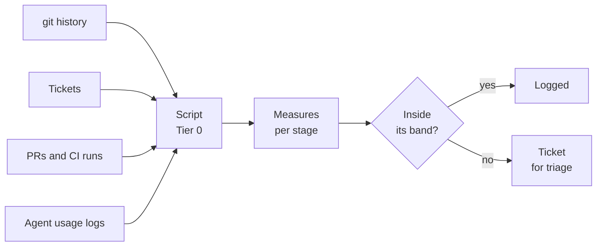
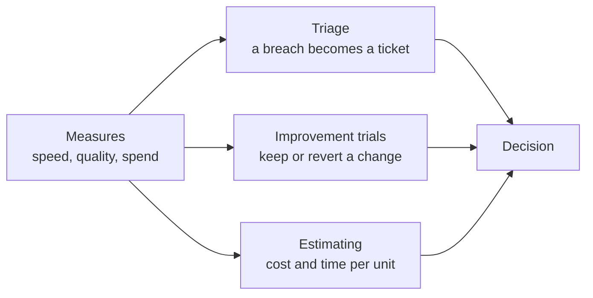
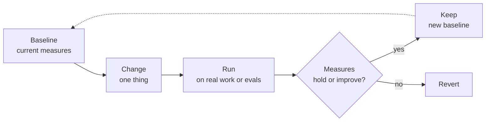

# Metrics: measuring the loop

Measuring is only worth doing when someone acts on the numbers (improve-by-measured-trial). Each measure here names the decision it informs. A measure that does not inform a decision is dropped.

Each stage has two measures (measure-the-loop):

- a **leading** measure, which shows speed and moves first
- a **lagging** measure, which shows quality and moves later

A script computes both from records the work already leaves: commits, tickets, pull requests (PRs), continuous integration (CI) runs and agent usage logs. The script does not need anyone to fill in a form or report a number by hand.

## Measures by stage

| Stage | Leading (speed) | Lagging (quality) | Computed from |
| --- | --- | --- | --- |
| 1 Scope | Time from request to approved ticket | Share of approved tickets that ship | Tickets |
| 2 Spec | Time from approved ticket to merged spec change | Pauses: spec changes after the first code commit, per component | Git history |
| 3 Plan | Time from merged spec change to approved plan | PRs whose diff reaches beyond the units their plan names | PR descriptions and diffs |
| 4 Build | First-pass CI rate: PRs green on their first run | Rework: fixes in the same component soon after a feature | CI runs; commit types |
| 5 Verify | Time to first review | Escapes: bugs found after merge that cite a requirement, against findings caught in review | Review threads; bug tickets |
| 6 Release | Lead time from approved ticket to merge or deploy | Change failure rate: releases followed by a fix or revert | Git history; releases |
| 7 Maintain | Time from breach to ticket | Repeat findings of the same class | Tickets |

The measures that span more than one stage:

- **Spend per merged unit**, by role: tokens or money for each merged PR. It shows whether leg 2 (giving each task the model and effort it needs, and no more) is economical.
- **Escalation rate**, by tier (the capability level a role maps to): escalations (an agent handing a question up a tier or to a human) per work unit. It shows whether a tier is set at the right level.
- **Eval pass rate** over time, described below.

Read spend and escalations together, and against a lagging quality measure such as rework:

| Spend | Escalations | Quality | Likely reading |
| --- | --- | --- | --- |
| Rising | Flat or falling | Flat | A tier or its effort is set too high |
| Flat | Rising | Falling | A tier is set too low |
| Falling | Flat | Flat | A cheaper mapping is working |

The eval pass rate moves when instructions or the tier-to-model mapping change (eval-instructions-on-change), and it gates a model swap (see [roles.md](roles.md)).

Release's two measures are half of DORA's four, the DevOps Research and Assessment group's delivery metrics. A project with a running service adds the other two: deployment frequency and time to restore service.

## What the numbers are for

| Use | The decision | Measures it reads | Section |
| --- | --- | --- | --- |
| Triage | Is something broken or drifting? | Every measure, against its band | Control bands |
| Improvement trials | Keep this change to the playbook, or revert it? | The measures the change should move, and the ones it might harm | Improvement trials |
| Estimating | What will this scope cost, and how long will it take? | Spend per merged unit, lead time | Estimating |

## Reading the numbers

- **A measure is a signal, never a target.** Goodhart's law: when a measure becomes a target, it stops being a good measure. Push first-pass CI rate as a goal, and agents learn to open smaller, emptier PRs.
- **Read per component, not across the repo.** A new component and a mature one behave differently, and an average hides both.
- **Pauses are read by age.** Many pauses in an early slice mean the team is learning; that is pause-on-discovery working. Pauses rising on a mature component mean interrogation (an agent hunting the spec for gaps before building) was too thin.
- **Start small.** A solo project starts with five: first-pass CI rate, rework, pauses, lead time and spend per merged unit. Add a measure when a real question needs it, not for completeness.

## Control bands (scripts-detect-models-diagnose)

A **control band** is the range a measure is expected to stay in, set from its own history. As a simplification, this section gives the band as the mean of its recent values, plus or minus some number of standard deviations (σ, sigma), and leaves out how many values count as recent.

| Where the value falls | Response |
| --- | --- |
| Within 1σ | Nothing |
| Beyond 1σ | Logged |
| Beyond 2σ | A ticket; a model diagnoses it, read-only |
| Beyond 3σ | A ticket at P1; an automatic fix only if it restores a requirement (fixes-restore-never-add) |

- **A script decides when a band is breached.** A model does not sit in the trigger. A model is called only to diagnose, and a human triages.
- **A measure has no band until it has history.** Until a measure has about twenty values, it is logged and never triggers.
- **The band thresholds live in the implementation layer**, in a file the owner approves changes to. The SDLC (software development life cycle) Playbook calls it `bands.yaml`. This repo does not name a file.

**Example.** For months, rework runs at about one fix for every four features. In the two weeks after the model behind the Implementer (the role that builds each unit of work) changes, it reaches one fix for every two. That is beyond 2σ. The script opens a ticket. A model reads the recent fixes and finds most touch skills the new model follows less well. The owner holds the swap, as in [roles.md](roles.md).

## Improvement trials (improve-by-measured-trial)

The playbook itself is improved by trial, one change at a time. A trial is to the playbook what an A/B flight is to the product (experiments-are-spec): written down first, measured, then kept or removed.

- **Write the trial first:** the change, the measures it should move, the ones it must not harm, the threshold and an end date.
- **Change one thing at a time.** Two changes at once leave you unable to tell which one moved the numbers.
- **Run long enough to compare.** As a simplification, this item gives one length for every trial: about twenty units of work, the same history a control band needs. Evals give a faster first read.
- **The owner decides** whether a trial runs and whether its result is kept (humans-decide-agents-record). An agent may propose a trial from a trend or an audit finding.

| Change tried | Measures it should move | Measures it must not harm |
| --- | --- | --- |
| A newer model, or a different effort, for one role | Spend per merged unit, lead time | Eval pass rate, rework, escapes |
| A faster CI tool or test runner | Time from push to a `verify` result | First-pass CI rate, escapes |
| A tighter spec template | Pauses, time from ticket to merged spec | Escapes, rework |
| Moving a step from a model into a script | Spend per merged unit | First-pass CI rate |

A model swap already runs this way, gated by evals. See [roles.md](roles.md).

**Example.** The Implementer role runs at medium effort. A trial lowers it to low effort for four weeks. Spend per merged unit falls by a third, the eval pass rate holds, and rework stays inside its band. The owner keeps the change, and the new figures become the baseline.

## Estimating

The same records answer a consultant's question: what does a unit of work cost, and how long does it take?

- **Cost per unit** is spend per merged unit, plus the human time a unit needs for answers, approvals and review.
- **Time per unit** is lead time from approved ticket to merge.
- **Estimate a scope** by counting its likely work units after Spec and Plan, then reading cost and time per unit from history.

As a simplification, the cost and time per unit above treat every unit as one size, and leave out that units vary in size. Use the range from history, such as the middle half of past units, not a single average, and quote the range. A new kind of work has no history yet, so its first estimate is a guess, marked as one.

How a consultant turns cost into a rate or a quote is a business decision, outside this playbook.

## Cadence

The script runs on a schedule, weekly by default, and after each release. The scheduled audit reviews the trends as well as the breaches (see [audit.md](audit.md)).
