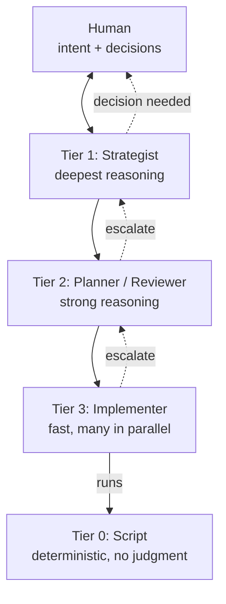
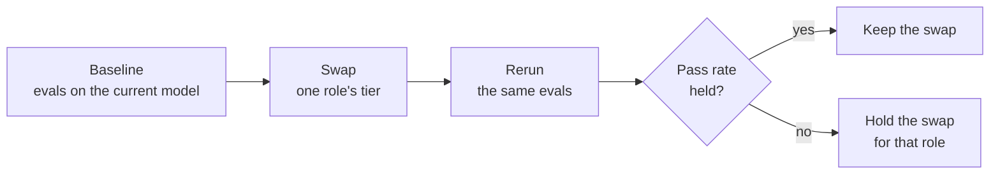

# Roles: the right agent for the task

Agents are assigned by role, and each role maps to a capability tier, never to a named model. A tier sets two dials: the model class and a default effort. When a new model ships, only the tier-to-model mapping changes, in the implementation layer. An eval suite proves the change is safe before it lands (eval-instructions-on-change).

Work flows down; questions flow up. A tier does not guess at something above its remit (match-capability-to-task).

Tier 0 is not a model. It is the scripts a model runs. It is the cheapest and most reliable worker, so any deterministic work goes there: parsing, diffing, validating, writing results (scripts-do-deterministic-work). A model stands between two commands only to make a judgment or to reach a tool a script cannot. See the seams in [traceability.md](traceability.md). Scripts also start Maintain work: a script detects a breach or drift, and a model is called only to diagnose it (scripts-detect-models-diagnose).

## Two dials: model and effort (match-capability-to-task)

Leg 2 of the playbook (agents matched to tasks by capability and cost) exists for economy as much as quality: each task gets the capability it needs, and no more. Capability has two dials, and both cost money and time.

| Dial | Examples | Set by |
| --- | --- | --- |
| Model class | Deepest reasoning, strong reasoning, fast | The role's tier |
| Effort | Reasoning or thinking budget; how many review passes; how many agents in parallel | The tier's default, raised for a hard task |

- **Start at the tier's default.** Raise effort for a task that is hard, not by habit.
- **Escalate rather than over-provision.** A fast implementer that meets a hard question hands it up (see the diagram). That is cheaper than running every unit at the top tier in case one needs it.
- **Spend follows risk, like autonomy.** A merge policy scales human attention to risk (autonomy-scales-with-risk). Effort scales the same way.
- **Under-spending is not economy.** A weak model at low effort on a design task costs more in rework than a strong one would have.

**Example.** A typo fix in user-facing text gets a fast implementer at low effort and one review pass at low effort. A change to the billing rules gets the same implementer tier, but the reviewer runs at high effort and a second review pass checks the money paths.

## Roles

| Role | Tier | Does | May write code? |
| --- | --- | --- | --- |
| Strategist | 1 | Architecture, hardest problems, whole-system audits | Rarely |
| Elicitor | 1 or 2 | Interrogates drafts, finds gaps and contradictions | No |
| Spec writer | 2 | Turns answers into spec text; keeps corpus consistent | No (spec only) |
| Planner | 2 | Breaks work into units, maps dependencies, batches parallel work | No |
| Reviewer | 2 | Reviews PRs for correctness and spec/code alignment, against the written review policy | No |
| Implementer | 3 | Builds one unit: code, tests; escalates spec gaps | Yes |
| Script | 0 | Parses, validates, diffs, writes results; runs the traceability checks | Is code |

The human who decides is the **owner**. The owner admits every need and constraint, and approves the requirements a PR lists (owner-admits-every-need).

## Rules

- **Pair every implementer with a reviewer** (separate-generation-from-verification). The reviewer starts from a fresh context, not the implementer's conversation.
- **Review against a written policy** (review-against-written-policy). The reviewer works from a review policy, not from its own taste. The policy names its passes, such as bugs, security and spec alignment. It uses the P0 to P3 scale the audit uses, and caps P3 nits so they cannot bury a real finding. Each project writes its policy in the implementation layer.
- **Script the deterministic work.** If a model carries a value from one command into the next, or edits a file by a fixed rule, move that work into the script.
- **Keep approval out of agent reach.** A rule an agent reads is a request. The owner's approval is enforced by a hook or CI check the agent cannot change (checks-over-instructions).
- **Give each role only the context it needs.** An implementer gets its unit and the relevant spec sections, not the whole corpus.
- **Escalate on ambiguity.** An implementer that meets a question the spec doesn't answer stops and escalates. A planner that cannot resolve it escalates to a strategist or the human.
- **Humans own the gates.** By default a human approves every merge. An agent may merge only under a written merge policy that names which changes qualify and which checks must pass. Each project defines that policy in its implementation layer, and a human can revoke it at any time.

**Humans, agents or both.** A human can fill any role, including Implementer, and a human and an agent can share one. Whoever writes the code follows the same rules: spec first, tests first, small PRs and independent review.

## Changing the mapping (eval-instructions-on-change)

A role's tier is stable. The model behind a tier is not, and neither is its default effort. Changing either is an improvement trial (improve-by-measured-trial), measured first by evals and then by spend and rework. See [metrics.md](metrics.md). An eval suite is what makes a swap safe: a set of real past tasks, each run through the agent's instructions and graded.

- **Swap one role at a time.** A drop then points at one role, not at the whole mapping.
- **Rerun on every change to the instructions,** not only to the model: the agent's instructions file (such as `CLAUDE.md`), skills, hooks and the review policy.
- **Grow the suite from failures.** A mistake that reached production becomes an eval and stays (repeat-mistakes-become-checks).

**Example.** The Implementer tier moves to a newer fast model. On twenty real tasks the pass rate drops from 18 to 15, all three failures on tasks that need a long spec read. The swap is held, and the Implementer stays on the previous model until the next candidate passes.

## Worked example of a mapping (implementation layer, not this repo)

One team in 2026 ran 8 implementer agents and 8 reviewer agents daily. They used the strongest model for strategy, a mid-tier model for planning, review and escalations, and a fast model for coding. Your skills or plugins would hold a table like that, and update it as models change, rerunning the eval suite each time.
