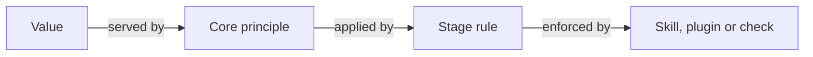

# Stage rules: how each stage applies the principles

The [core principles](README.md#core-principles) say what the playbook holds to. The stage rules here say how a stage applies them. Most stage rules name a command, a format or a scale, so they change more often than the core.

A stage rule has a stable ID like a core principle, and skills and plugins cite it the same way. The **Applies** column names the core principle each rule puts into practice.

Each rule is explained in full, with examples, in its stage's document: [lifecycle.md](lifecycle.md) for Scope to Release, [roles.md](roles.md) for evals and review, [audit.md](audit.md) and [metrics.md](metrics.md) for Maintain. Search for the ID.

| Stage | ID | Rule | Applies | Serves | Why | Anti-pattern |
| --- | --- | --- | --- | --- | --- | --- |
| All stages | repeat-mistakes-become-checks | A mistake made twice becomes a rule in the agent's instructions. Made again, or costly, it becomes a check or hook. If it reaches production, it becomes an eval. | checks-over-instructions | Enforced checks | Each repeat climbs to a stronger control, and a rule an agent only reads is a request. | Correcting the same agent mistake in chat every week. |
| Scope | spec-next-increment-deeply | Full detail only for the increment being built next; later work stays an outline. | slice-thin-increments | Living specs | Detail written too early goes stale before it is used. | Polishing specs for features months away. |
| Spec | list-out-of-scope-first | Each spec opens with what it deliberately does not do. | trace-behavior-to-need | Stated needs, Shared understanding | An agent can see a feature is unwanted before building it, and a client can see what they are not getting. | A spec silent on scope, so every gap looks like an invitation. |
| Spec | defer-decisions-explicitly | Mark a question "decide later" with a trigger, instead of forcing an answer now. | humans-decide-agents-record | Explicit decisions | Some answers only become clear once users see the product. | Guessing early, or leaving gaps unmarked. |
| Spec | prototype-to-learn | A prototype answers a named question; its findings go into the spec, and its code is discarded or rebuilt from the spec. | spec-is-source-of-truth | Living specs | Prototypes are the cheapest way to learn, but prototype code bypasses the spec. | A prototype quietly becoming production code. |
| Spec | load-policies-while-specifying | Policies such as security, privacy and style are loaded while the spec is written. A constraint may cite a policy and its version. | source-needs-outside-code | Stated needs | A policy found at review means rework. | Security rules first read on the PR. |
| Plan | decompose-into-parallel-units | Decompose work into independent units that can run in parallel. | match-capability-to-task | Proportionate capability | Clear units make parallel agents safe and reviews small, and let a fast, cheap tier do the building. | One agent on a sprawling multi-feature change. |
| Plan | approve-plan-before-code | A written plan, approved by the owner, comes before code. Each unit names the requirement IDs it builds. A one-unit fix may skip the approval. | humans-decide-agents-record | Explicit decisions | A misunderstanding is cheapest to catch in a plan, before the diff exists. | An agent going straight from a ticket to a 40-file diff. |
| Build | stack-small-reviewable-prs | Each PR is one logical, reviewable change. Larger work lands as a stair-step of small PRs, each building on the last. | separate-generation-from-verification | Verified behavior | Reviewers, human or agent, catch far more in small diffs, and one bad step can be reverted alone. | A PR touching hundreds of files, unless the change is mechanical, such as a rename or a formatter run. |
| Build | write-behavior-tests-first | Implementers prefer test-driven development: write a failing test, then the code that passes it. Tests follow a behavior-driven pattern, describe/it, with no "should" in the it phrase. Example: describe("invoice") / it("locks once paid"). | trace-behavior-to-need | Verified behavior | Each test checks one requirement and cites its ID, so its name reads like a spec rule. The test checks the spec; it is not a second copy of it (one-home-per-artifact). | Tests written after the code to hit a coverage number, with names like "it should work." |
| Build | analyze-impact-first | Analyze a change's impact against the spec before making it. | pause-on-discovery | Living specs | Surprises are cheapest before the code exists. | Discovering corner cases in production. |
| Build | change-spec-before-code | Every behavior change starts in the spec; code follows the updated spec. A change that leaves behavior alone, such as a typo fix or a refactor, does not need a spec change. | spec-is-source-of-truth | Living specs | The spec stays the plan, not a record written after the fact. | Changing the code, then backfilling the spec. |
| Build | one-command-per-gate | Every repo exposes `build`, `test`, `check` and `verify`, each inside the next. `check` gates Build; `verify` gates Verify. The playbook names the verbs; each repo's task runner defines them. | checks-over-instructions | Verified behavior | One vocabulary across languages, and CI runs the same command the agent ran. | An agent that must remember twenty CI steps, or stops at a green `test`. |
| Verify | no-merge-without-alignment | No merge without spec/code alignment. | spec-is-source-of-truth | Living specs | Drift starts one PR at a time. | Promising to "update the docs later." |
| Verify | review-against-written-policy | Reviewers work from a written review policy: its passes, the P0 to P3 scale and a cap on nits. | separate-generation-from-verification | Verified behavior | One policy on every PR makes reviews comparable and keeps nits from burying real findings. | Thirty nits and one buried bug. |
| Verify | eval-instructions-on-change | Evals run whenever an agent's instructions change: its instructions file (such as `CLAUDE.md`), skills, hooks or the tier-to-model mapping. | checks-over-instructions | Verified behavior, Measured improvement | A test checks code. Only an eval checks what a model does with its instructions, and a model swap is a trial measured by evals. | Rewording a skill or swapping a model, and finding out from users. |
| Release | experiments-are-spec | An A/B flight is specified as a hypothesis, variants and a success metric; the winner becomes the spec and the loser is removed. | spec-is-source-of-truth | Living specs | The rule keeps experiments measurable and the spec truthful. | Leaving both variants in the code with the spec undecided. |
| Maintain | audit-on-schedule | Audit the whole system on a schedule, with a repeatable process. | spec-is-source-of-truth | Living specs, Measured improvement | Per-PR checks miss slow, system-wide drift. | One-off audits that nobody can rerun. |
| Maintain | scripts-detect-models-diagnose | A script detects drift or a breach; a model is called only to diagnose it. Starting is deterministic; deciding is human. | scripts-do-deterministic-work | Proportionate capability | Deterministic triggers are cheap, repeatable and auditable. | A model polling metrics and deciding when to act. |
| Maintain | fixes-restore-never-add | An automatic fix may restore a requirement that is breaking. It may never add one. New behavior goes through the owner (owner-admits-every-need). | owner-admits-every-need | Stated needs | The rule keeps automation inside trace-behavior-to-need. | A bot adding retry logic that nobody specified. |
| Maintain | measure-the-loop | Each stage has a leading (speed) and a lagging (quality) measure, computed by a script, plus spend across stages. Each measure names the decision it informs; one that does not inform a decision is dropped. | improve-by-measured-trial | Measured improvement, Verified behavior | Without numbers, nobody can tell whether a change to the process helped, or what a unit of work costs. | Judging the playbook by feel, or collecting numbers that nobody acts on. |
