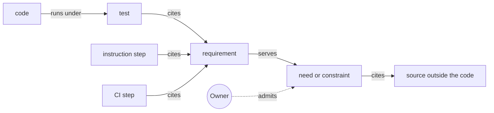
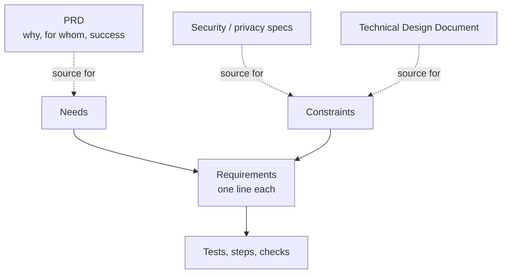
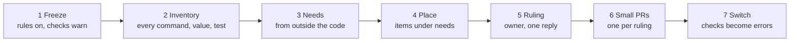

# Traceability: needs before code

The spec says what the product should be. Traceability ties every behavior in the code to the reason it exists, so nothing gets built that nobody asked for (trace-behavior-to-need).

This practice comes from the "needs before code" method in the claude-plugins repo, [SPEC-METHODOLOGY.md](https://github.com/ScottHysom/claude-plugins/blob/main/SPEC-METHODOLOGY.md). That file is the worked example. It holds the mechanics this repo leaves out: the spec-file grammar, the id rules, test markers, and the scripts that run the checks.

## The problem

An agent filling a gap guesses. It completes a pattern, adds an option a person would have stopped to ask about, or guards against an input nothing produces. Martin Fowler and Kent Beck call this *speculative generality*: machinery built for a need nobody has.

Tests don't catch it. A test shows that a behavior works. It says nothing about whether anyone needs it.

**Example.** In claude-plugins, an agent gave every rule in a rules file a `source` key with four allowed values.

- The key arrived inside a 3,686-line pull request (PR), too large to weigh each behavior.
- A later ticket, written against the code as it stood, required a script to write one of the values.
- Asked why the key existed, an agent defended it by symmetry: one value per route into the file.
- Nothing read the key, and nothing wrote two of its values.

An audit then found about one behavior in six with no written need.

## The test

A behavior is justified by one of two things:

- a **need**, which someone wants
- a **constraint**, which the platform forces

Symmetry, completeness and "it might be useful" are neither. A behavior with no need or constraint has no place in the code.

## Needs, constraints and requirements

| Item | What it says | Form | Cites |
| --- | --- | --- | --- |
| Need | Who wants what outcome, and why | A job story: "When <situation>, <role> wants <outcome>, so <reason>." | A source outside the code: the client's words, a brief, a ticket |
| Constraint | A platform fact that forces a design | The fact, and what it forces | Where the fact is recorded: vendor docs, a law, a measured limit |
| Requirement | One behavior, in one sentence | EARS order: "When <trigger>, <component> <response>." | Nothing. It sits under the need or constraint it serves |

EARS is the Easy Approach to Requirements Syntax: templated sentences that open with the trigger. The nesting is the whole trace. A requirement under a need is justified by that need.

Each spec file opens with an **Out of scope** list (list-out-of-scope-first). It names what the component deliberately does not do, so an agent sees a feature is unwanted before building it.

**Example (simplified).** One section of a spec file for a car rental service:

```markdown
## Out of scope

- Selling cars. The service only rents them.

## need user-checks-each-charge: Check each charge on a returned car

When a renter returns a car, they want every charge listed on the receipt,
so they can check each one against the agreement they signed.

Source: the product brief, under "Receipts".

- `close-cmd-lists-each-charge` (test): When `rentals close` ends a rental,
  it prints one line per charge, with its amount and its reason.
- `close-cmd-shows-late-fee` (test): When the car comes back late, the
  receipt shows the late fee on a line of its own.
```

Each requirement has a stable id that reads as a short sentence, subject first. Requirement ids and principle ids are separate namespaces: principles are rules for the people and agents doing the work; requirements are behaviors of the product.

### Requirement kinds

Each requirement names its kind: what verifies it.

| Kind | Verified by | Example |
| --- | --- | --- |
| test | An automated test that cites the requirement id | A unit test tagged with `close-cmd-shows-late-fee` |
| step | A step in an agent's instructions (a skill) that cites it | "Ask all open questions in one batch" |
| check | A continuous integration (CI) workflow step that cites it | A lint step |
| eval | An eval: a set task run through the agent's instructions, then graded | Optional. Closes the gap that a step marker leaves |

## The chain

A behavior reaches its reason through a chain. Read each arrow as a sentence, from the code up.



A machine checks every link on every PR (checks-over-instructions):

| Link | Fails when |
| --- | --- |
| Code runs under a test | A PR adds a line no test runs, or coverage falls below its floor |
| A test or step cites a requirement | It cites nothing, or an id no spec holds |
| Each requirement is cited by something of its kind | Nothing verifies it |
| Each requirement sits under a need or constraint | It sits outside any |
| A PR lists the requirements it changes | Its description leaves one out |

Coverage is the link most easily left out. In the `source` example, no test ran the code that checked the key's values. A trace through tests alone would have passed. Coverage forces a test onto new logic; the trace forces that test to cite a requirement.

Two judgments stay with the owner, because no script can make them:

- Is the need real?
- Does the requirement truly serve the need it sits under?

The chain makes those judgments cheap. Each behavior is one short line in a spec file, not a buried change in a long diff.

## Where it sits in the spec corpus

The needs spec is the traceable layer of every corpus (see [lifecycle.md](lifecycle.md)). It lives in a `specs/` folder: one file per component, plus one for what the whole repo shares.



- **Small project.** The needs spec *is* the product spec. Other documents are optional.
- **Bigger project.** The PRD, design documents, and privacy and security specs sit above it. A need's `Source:` line cites a PRD section. A constraint cites the security spec or the Technical Design Document.

A first cut at what each larger document contributes, *simplified*:

| Document | Becomes needs or constraints | Not covered by needs and constraints |
| --- | --- | --- |
| PRD | Goals and users become needs | Success metrics; product strategy |
| Product spec | Its rules become requirements under needs | Screen flow and narrative, if kept |
| Technical Design Document | Platform facts become constraints | Architecture choices and their reasons (ADRs) |
| Design system | Behavioral rules become requirements | Visual tokens and components |
| Privacy and security specs | Legal and threat facts become constraints | The threat model as a whole |

How much of the right-hand column a bigger project still needs is an open question. See the README.

## Admission: the owner controls what enters

A new need or constraint is the decision that matters most. Either one justifies behavior, so a constraint an agent invented would let in behavior nobody asked for. So it enters only through the owner (owner-admits-every-need).

| What changes | Where it is approved |
| --- | --- |
| A new need or constraint | The owner's approval of the ticket that names it |
| A new or changed requirement under an existing need | Listed in the PR description; the owner approves it in review |
| A removed requirement | Listed in the PR description; the line is deleted, and version control keeps it |

A ticket carries a "Requirements" field listing the ids it adds, changes or removes, or the id a bug breaks. Approving the ticket approves those lines explicitly.

**Example.** An agent wrote a ticket against the code as it stood. Its "Done when" line required a script to write one of the `source` values. Approving the idea approved the key, and nobody saw it happen. A "Requirements" field would have put the key in front of the owner.

**Requests and controls.** A rule an agent reads is a request. A check the agent can edit is a weak control. The owner's approval is the control to keep out of the agent's reach. Where agents post under the owner's account, a hook stops an agent adding the approval label, and CI refuses work on a ticket that lacks it.

## Scripts and models (leg 2)

Traceability also sharpens the second leg: the right worker for each task. The cheapest worker is a script. See Tier 0 in [roles.md](roles.md) (scripts-do-deterministic-work).

- **The script** does deterministic work, where two runs on the same input should give the same answer: parsing, selecting files, diffing, validating, writing results.
- **The model** does only what needs judgment: inferring a rule, writing prose, deciding whether something conforms. It also calls tools a script cannot reach.

A **seam** is a point where the model stands between one command's output and the next command. There are three kinds:

| Seam | What the model does | Keep it? |
| --- | --- | --- |
| Judgment | Decides something, or relays the user's decision | Yes |
| Platform | Calls a tool a script cannot reach, such as asking the user a question | Yes |
| Courier | Carries a value, maps an exit code, re-verifies output, or edits a file by rule | No. Move the work into the script |

A courier seam costs context on every run and is a place the model can go wrong.

**Example.** A rental quote command prints a short token: a hash of the price the renter was shown. The hold command refuses to reserve a car without it. The token carries the renter's approval across a judgment seam, and the model never re-types the price.

## Rules for agents

Put these where the agent reads them every session, such as `CLAUDE.md` or `AGENTS.md`:

- Build only what a requirement asks for. Before adding a command, option, value, refusal or branch, find the requirement it serves.
- A behavior is justified by a need or a constraint. Symmetry, completeness and "it might be useful" are neither.
- When no requirement covers the work, stop. Propose the requirement, and the need or constraint it serves, in the ticket or PR. Wait for the owner.
- Asked why a behavior exists, answer with its requirement and need. If it has none, say so and file a ticket. Do not defend it by the design's own consistency.
- Put the model between two commands only at a judgment or platform seam.

## Adopting it

### A new codebase

Write the needs spec with the first feature. Add the rules for agents, the out-of-scope list and the first needs. Turn the checks on as errors from day one. There is nothing to sift.

### An existing codebase

The trap: an agent reading code finds a reason for everything in it. A spec written that way records guesses as requirements. So needs come from sources outside the code, never from reading it (source-needs-outside-code). Work one component at a time:



Each item an agent cannot place goes to the owner with evidence and a recommended outcome:

- **Remove.** Nothing calls it, and no need asks for it.
- **Keep.** The owner states the need.
- **Wire up.** The need is real, but nothing uses the behavior yet.
- **Fix.** The need is real, and the behavior is wrong.
- **Probe.** It claims a platform limit nobody has measured.
- **Merge.** It is a courier seam; move its work into the script.

Checks start as warnings. Each flagged item waits on a list keyed to the ticket that will fix it. The list only shrinks, and an entry whose ticket has closed fails.

## Keeping it light

Spec-driven tools draw four common criticisms. This practice is built to avoid each one.

| Criticism | How this practice avoids it |
| --- | --- |
| Volume: long generated specs are harder to review than code | A behavior is one line. No document per feature |
| Guessing: tools tell the model to guess and record an assumption | A guess goes to the owner as an unplaced item, not into the spec |
| Stale specs | A requirement nothing verifies fails the trace |
| False control: an agent can ignore a spec it only reads | CI checks every link; admission rides on the owner's approval |

## Schemes considered

- **Use cases** (Alistair Cockburn). Good at stating a need, and the job story and out-of-scope list keep that. Too coarse as the unit a test cites: a new behavior can hide under a broad use case.
- **Executable examples** (behavior-driven development, BDD: Given / When / Then). The tests here are the examples. But a scenario says what happens, not whether anyone wants it.
- **A spec-driven tool adopted whole** (for example OpenSpec or GitHub Spec Kit). Each brings its own record of change, which drifts from the tickets. This practice borrows their formats and keeps the ticket as the only record of change.

## Sources

- [SPEC-METHODOLOGY.md](https://github.com/ScottHysom/claude-plugins/blob/main/SPEC-METHODOLOGY.md), claude-plugins. The method in full, with its mechanics and history.
- Martin Fowler, with Kent Beck, *Refactoring* (1999), chapter 3, for speculative generality.
- Alistair Mavin et al., "Easy Approach to Requirements Syntax (EARS)", RE'09, [doi:10.1109/RE.2009.9](https://doi.org/10.1109/RE.2009.9).
